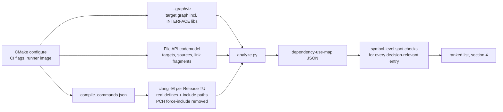

# Dependency/use map and keep/remove/optionalize ranking

**Status:** Slice 1 of [#47](https://github.com/dvystrcil/quality-first-slicer/issues/47) (AC1: dependency/use map; AC2: no "unused" claim from a missing include alone). Read-only analysis; **no source, build file or notice has been removed.**
**Analysed source:** fork [`dvystrcil/OrcaSlicer`](https://github.com/dvystrcil/OrcaSlicer) branch `baseline-2.4.2`, commit `5ed77f50ccadee8eec5d72da07e57a3a54b608c9` (upstream v2.4.2 plus the fork's CI changes; no slicer source changes)
**Configuration:** Linux x86_64, the fork's CI configure (`build_linux.sh -istrlL`): clang 18.1.3, CMake 3.28.3, `Ninja Multi-Config`, Release, `SLIC3R_GUI=ON`, `SLIC3R_STATIC=ON`, `SLIC3R_PCH=ON`, `ORCA_TOOLS=ON`, `BUILD_TESTS=ON`, GTK3, dependency prefix `deps/build/OrcaSlicer_dep` built by the same CI runner image
**Reviewed:** 2026-11-08
**Machine-readable result:** [`audit/dependency-use-map-linux-x86_64.json`](../audit/dependency-use-map-linux-x86_64.json)
**Reproduce:** [`tools/dependency-use-map/run.sh`](../tools/dependency-use-map/run.sh)

This is an engineering reachability analysis. Where it mentions license text, it records what the files say so that qualified reviewers know where to look. It does not reach legal conclusions.

## 1. Method

The earlier audits read CMake files and source remotely. This pass uses the build system's own view of one real configuration and adds three evidence layers.



| Layer | What it proves | What it cannot prove |
|---|---|---|
| **Link graph**: `cmake --graphviz` plus the File API | Which CMake targets and libraries are in the `OrcaSlicer` executable's link closure | Use of header-only code, which needs no link edge. Whether the linker actually extracts an object from a static archive |
| **Preprocessor closure**: `clang -M` on all **801** Release translation units (TUs), 0 failures | Which headers each TU really includes after this configuration's `#if`/`#ifdef` resolution, defines and include paths | Whether included code is called. A header can be included while its macros expand to nothing |
| **Symbol spot checks** (`grep` for API calls in the consumer TUs that layer 2 found) | That the consumer actually calls the dependency's API | Runtime reachability from the UI. Dead code inside a caller |

The precompiled header is excluded on purpose. With PCH on, every `libslic3r` TU appears to include every header in `pchheader.hpp`. For example, all 205 `libslic3r` TUs "include" Shiny, but only 4 do so themselves. The PCH-inflated numbers would make every dependency look core.

### Coverage limits (AC2)

- **One platform and one configuration.** Windows (MSVC), macOS, MinGW and Flatpak were not configured. Section 5 marks entries whose conclusion depends on another platform; those rest only on reading the CMake.
- **Runtime-loaded code is outside every layer.** `src/slic3r/Utils/BBLNetworkPlugin.cpp` loads the Bambu networking plugin with `dlopen`/`LoadLibrary`, and `MediaPlayCtrl.cpp` loads `BambuSource`. Neither is built from this tree or appears in the CMake graph, so neither is mapped here.
- **Generated code was covered.** Configure-time generated headers (`GeneratedConfig.hpp`, version headers under the build tree) were present and are included in the closure. No TU failed to preprocess, so no build-time generated header was missing.
- **Header-level ≠ object-level.** The final evidence that a removal is safe is the removal PR's own build. That means a linker check (`-Wl,--trace-symbol` or `--why-extract` with lld, or a map file) plus the test suites. This document identifies candidates and does not replace that check.

## 2. Build-graph findings

### 2.1 Targets built but not in the application link closure

The `OrcaSlicer` link closure contains 238 graph nodes. The following targets are **not** in it:

| Target | Kind | Why it is outside | Consequence |
|---|---|---|---|
| `agg`, `ankerl`, `earcut`, `fast_float`, `nanosvg`, `nlohmann_json`, `stb_dxt` | Header-only INTERFACE | Never linked by name. Every core target reaches them through the include directory `deps_src/admesh/..`, which is all of `deps_src/` (see 2.2) | **Not unused.** Section 3 shows 1–360 application TUs each. A link-graph-only audit would wrongly call all seven unused |
| `expat` (`deps_src/expat`) | STATIC, 16 sources | Compiled in `all`; nothing links it. The app links system `libexpat.so` | **No consumer in this configuration**: 0 TUs include its headers outside its own directory. See R2 |
| `Shiny` | STATIC, 20 sources | Compiled in `all`; linked only when `SLIC3R_PROFILE` is set (default `0`) | Headers are included by 4 TUs, but the macros are empty without `SLIC3R_PROFILE`. See R4 |
| `hints` / `hintsToPot` | Build tool | Runs under the `gettext_make_pot` target only | Internal translation tooling, not shipped. Keep |
| `encoding-check` | Build tool | Source-encoding checker | Build-time only. Keep |
| `OrcaSlicer_profile_validator`, `*_tests`, `Catch2*` | Tool / tests | Separate executables | The validator's link closure is a subset of the app's |

### 2.2 The `deps_src/admesh/..` include path

`admesh`'s CMake publishes `deps_src/admesh/..` as an include directory, and that directory **is `deps_src/` itself**. Every target that links `admesh` (`libslic3r`, `libslic3r_cgal`, `libslic3r_gui` and everything above them) can therefore `#include` any vendored component with no CMake edge. Concretely:

- An include-graph or CMake-graph audit undercounts consumers.
- Removing a vendored directory can break code that never declared a dependency on it.
- Removing a dependency's *target* does not remove its *headers* from reach.

The removal PRs must therefore check the TU closure (re-run `run.sh`), not only the CMake graph.

### 2.3 Dependency-superbuild (`deps/`) projects with no consumer

`deps/CMakeLists.txt` adds `dep_OpenCSG` to `_dep_list`, and `dep_OpenCSG` depends on `dep_GLEW`. Both are built and installed into the prefix (`libopencsg.a`, `libGLEW.a`). **No application, test or tool target links either of them.** The only consumer is `sandboxes/opencsg`, and its `add_subdirectory` is commented out in `sandboxes/CMakeLists.txt`. The remaining mention, in `src/libslic3r/CSGMesh/CSGMesh.hpp:12`, is a comment. The application uses `glad` as its OpenGL loader, not GLEW. See R1.

## 3. Use map (application consumers)

Columns:

- **App TUs**: TUs in the `OrcaSlicer` link closure whose own include closure reaches the component, PCH excluded.
- **Tests**: TUs outside the closure.
- **Callers**: the consumer TUs, for low fan-in components.
- **Call check**: the symbol spot check.

`L/` means `src/libslic3r/` and `S/` means `src/slic3r/`.

### 3.1 Vendored `deps_src/` components

| Component | App TUs | Tests | Callers / main consumers | Call check | Feature |
|---|---:|---:|---|---|---|
| admesh | 292 | 32 | via `TriangleMesh.hpp` (ubiquitous) | API calls in `L/TriangleMesh.cpp` (prior review) | STL load + repair |
| agg | 5 | 5 | `L/SLA/RasterBase.cpp`, `L/SLA/RasterToPolygons.cpp`, `L/Support/SupportMaterial.cpp`, `S/GUI/Jobs/CreateFont*ImageJob.cpp` | includes in FDM support + emboss font preview | Rasterisation |
| ankerl | 6 | 1 | `L/Arachne/*`, `L/Fill/FillConcentric*.cpp`, `L/PerimeterGenerator.cpp` | prior review | Arachne walls |
| clipper | 118 | 16 | ubiquitous | — | Polygon ops (core) |
| clipper2 | 2 | 0 | `L/Clipper2Utils.cpp`, `L/Fill/FillBase.cpp` | 48 `Clipper2Lib::` uses in `Clipper2Utils.cpp` | Infill |
| earcut | 1 | 0 | `S/GUI/SkipPartCanvas.cpp` | `mapbox::earcut` called | Part-skip canvas (printer-side skip-object UI) |
| fast_float | 9 | 0 | `L/Format/3mf.cpp`, `bbs_3mf.cpp`, `GCodeProcessor.cpp`, `GCodeReader.cpp`, … | prior review | Number parsing (core) |
| glu-libtess | 1 | 0 | `L/Tesselate.cpp` | 22 `gluTess*` calls | Polygon triangulation |
| hidapi | 5 | 0 | `S/GUI/Mouse3DController.cpp` (+4 TUs that only include `Mouse3DController.hpp`) | `hid_*` calls **only** in `Mouse3DController.cpp` | 3D mouse |
| imgui | 280 | 0 | GUI-wide | — | GUI (core) |
| imguizmo | 1 | 0 | `S/GUI/GLCanvas3D.cpp` | 17 `ImGuizmo::` uses | View gizmo |
| libigl | 42 | 4 | 30 `libslic3r` + 3 `libslic3r_cgal` + 8 GUI; 174 of 639 vendored headers reached | prior closure review | Mesh algorithms, CGAL boolean bridge |
| libnest2d | 8 | 3 | `L/Arrange.cpp`, `L/Support/TreeSupport.cpp`, `S/GUI/Jobs/ArrangeJob.cpp`, … | — | Arrange (core) |
| mcut | 1 | 0 | `L/MeshBoolean.cpp` (`libslic3r_cgal`) | `mcDispatch`/`mcCreateContext` called | Mesh boolean / cut |
| md4c | 1 | 0 | `S/GUI/ReleaseNote.cpp` | `md_html(` called | Release-notes rendering |
| mdns | 1 | 0 | `S/Utils/CrealityHostDiscovery.cpp` ← `S/GUI/CrealityDiscoveryDialog.cpp` ← `S/GUI/PhysicalPrinterDialog.cpp` | `cxnet::syncDiscoveryService` called | Creality LAN discovery |
| **minilzo** | 1 | 0 | `S/Utils/minilzo_extension.cpp` only | **0 callers** of `lzo_compress`/`lzo_decompress`; `minilzo_extension.hpp` is included by nothing else | **None** (see R3) |
| miniz | 27 | 0 | 3MF, archive I/O | — | Project files (core) |
| nanosvg | 257 | 23 | GUI icons, emboss | — | SVG (core) |
| nlohmann | 360 | 25 | ubiquitous | — | JSON (core) |
| qoi | 1 | 0 | `L/GCode/Thumbnails.cpp` | `qoi_encode` called | QOI G-code thumbnails |
| semver | 494 | 48 | ubiquitous | — | Version handling (core) |
| Shiny | 4 | 0 | `L/GCode.cpp`, `L/GCodeReader.cpp`, `L/PrintObject.cpp`, `L/pchheader.cpp` | macros are no-ops unless `SLIC3R_PROFILE` (`Shiny.h:32`, `ShinyMacros.h:28`) | **None** in default build (profiler) |
| stb_dxt | 1 | 0 | `S/GUI/GLTexture.cpp` | `stb_compress_dxt` called | Texture compression |
| expat (vendored 2.2.0) | **0** | 0 | — | — | **None**: system/prefix Expat is used |
| qhull (vendored 7.2.0) | **0** | 0 | — | — | **None on Linux**: prefix Qhull 8.0.2 is used (`prefix/qhull` below) |

### 3.2 Dependency-prefix (`deps/`) components

| Component | App TUs | Callers / main consumers | Feature |
|---|---:|---|---|
| Boost, Eigen, oneTBB, cereal | 435–572 | ubiquitous | Core |
| OpenSSL / curl | 396 / 242 | GUI networking and updates (header fan-in is broad; call sites not enumerated) | Network, updates |
| wxWidgets 3.3 | 323 | GUI | Core GUI |
| OCCT (26 `TK*` libraries) | 247 | `L/Format/STEP.hpp` includes OCCT headers, so every TU that includes it is counted; the importer is `L/Format/STEP.cpp` | STEP import |
| CGAL (+ GMP, MPFR) | 5 | `L/CutSurface.cpp`, `L/Geometry/VoronoiUtilsCgal.cpp`, `L/MeshBoolean.cpp`, `L/Triangulation.cpp`, `S/GUI/Selection.cpp` (min-sphere only) | Cut, boolean, Voronoi checks |
| OpenCV 4.6.0 `world` (core, imgproc, imgcodecs) | 6 | `L/ObjColorUtils.cpp` (`cv::kmeans`), `S/GUI/ObjColorDialog.cpp`, `S/GUI/PartSkipDialog.cpp`, `S/GUI/SkipPartCanvas.cpp` (`findContours`, `drawContours`, `imread`) | OBJ colour clustering; part-skip |
| NLopt | 5 | `deps_src/libnest2d`, `L/Arrange.cpp`, `L/SLA/Rotfinder.cpp`, `L/SLA/SupportTree*.cpp` | Arrange optimiser |
| Qhull 8.0.2 | 1 | `L/TriangleMesh.cpp` (`orgQhull`) | Convex hull |
| OpenVDB (+ Blosc, OpenEXR `Half`) | 2 | `L/OpenVDBUtils.cpp`, `L/SLA/Hollowing.cpp` | **SLA hollowing only** (see O3) |
| Draco | 1 | `L/Format/DRC.cpp` | `.drc` import |
| libnoise | 1 | `L/Feature/FuzzySkin/FuzzySkin.cpp` (12 `noise::` uses) | Fuzzy-skin noise modes |
| libjpeg-turbo / libpng | 1 / 2 | `L/GCode/Thumbnails.cpp`; `L/PNGReadWrite.cpp`, `L/EdgeGrid.cpp` | Thumbnails, PNG I/O |
| FreeType | 0 (link only) | No application TU includes FreeType headers; it is on the link line for other libraries (not traced which: OCCT `TKService` or wxWidgets are candidates) | Indirect |
| GLFW 3.4 | 1 | `src/OrcaSlicer.cpp`: `glfwInit` creates an off-screen GL context for CLI thumbnail rendering | CLI slicing with thumbnails |
| OpenCSG 1.4.2 + GLEW | **0** | — | **None** (2.3) |

### 3.3 Notable system libraries (Linux)

| Library | App TUs | Consumer | Feature |
|---|---:|---|---|
| libspnav (static, when found) | 1 | `S/GUI/Mouse3DController.cpp` (`spnav_open`) | 3D mouse via spacenavd. Linked statically only if `libspnav.a` is found (`CMakeLists.txt:769`); it was found on the runner |
| webkit2gtk-4.1, libsoup-3.0 | 1 | `S/GUI/PrinterWebView.cpp` | Embedded printer web UI |
| GStreamer | 2 | `S/GUI/wxMediaCtrl2.cpp`, `S/GUI/Printer/gstbambusrc.c` | Printer camera stream |
| libsecret | 0 (link only) | No TU includes it. It is reached through wxWidgets `wxSecretStore` (`wxUSE_SECRETSTORE 1` in the prefix `setup.h`), used by `S/Utils/OrcaCloudServiceAgent.cpp` | Cloud-login token storage |
| D-Bus | 1 | `S/GUI/InstanceCheck.cpp` | Single-instance messaging |
| Expat (system) | 7 | `L/Format/3mf.cpp`, `AMF.cpp`, `bbs_3mf.cpp`, `L/Model.cpp`, GUI part-skip | XML parsing (core) |

### 3.4 Duplicated or overlapping capabilities

| Capability | Implementations present | Observation |
|---|---|---|
| XML parsing | system/prefix Expat (used); `deps_src/expat` 2.2.0 (unused); `deps/EXPAT` 2.5.0 (fallback ExternalProject); wx built-in expat filtered out of `wxWidgets_LIBRARIES` (`src/CMakeLists.txt:75`) | One provider per platform is enough. The root `CMakeLists.txt:676-687` fallback points at `src/expat/*.c`, **which does not exist**, so that branch could not configure if it ever ran. See R2 |
| PNG | prefix `libpng.a` **and** OpenCV's bundled `opencv4/3rdparty/liblibpng.a`, both on the final link line | Two libpng copies in one binary. Which one resolves each `png_*` symbol was not verified. Follow-up for O5 |
| Convex hull | Qhull (prefix 8.0.2, used); `deps_src/qhull` 7.2.0 (Linux: unused); CGAL | Windows: `dep_Qhull` is commented out for MSVC in `deps/CMakeLists.txt`, so **Windows likely uses the vendored 7.2.0**. Not verified (no Windows configure) |
| Mesh boolean | MCUT (GPL-3.0-or-later default), and CGAL-based boolean operations (via libigl's CGAL bridge) in the same `MeshBoolean.cpp` | Already covered in [MCUT/libigl review](mcut-libigl-license-review.md). See O4 |
| Polygon triangulation | glu-libtess (`Tesselate.cpp`), earcut (`SkipPartCanvas.cpp`), CGAL (`Triangulation.cpp`) | Three implementations with distinct consumers. Consolidation would be a code change, not a removal; low priority |
| Polygon clipping | Clipper 6.4.2 (ubiquitous), Clipper2 1.5.2 (2 TUs) | Both Boost Software License; low licensing value |
| GL loader / context | glad (used), GLEW (unused, 2.3), GLFW (CLI off-screen context) | GLEW is removable together with OpenCSG |
| Compression | miniz (3MF), minilzo (unused, R3), zlib, Blosc (OpenVDB only), liblzma (shared; which dependency pulls it in was not traced) | minilzo and, with O3, Blosc drop out |

## 4. Ranked decision list

> **Update (2026-11-08):** maintainer decisions now apply to several items. The base moves to OrcaSlicer 2.5.0 ([0002](decisions/0002-base-on-orcaslicer-2.5.0.md)), where R1 is already done upstream and this map must be re-run. SLA (O3) is to be removed ([0003](decisions/0003-remove-sla.md)), Creality discovery (O1) is to be removed ([0004](decisions/0004-remove-creality-lan-discovery.md)), and the 3D mouse (O2) becomes an option that is off in project builds ([0005](decisions/0005-3d-mouse-optional-off.md)). The table below is the original v2.4.2 analysis.

Ranking puts licensing/provenance burden removed per unit of risk first. Feature-impact statements describe effects on users. Every entry still needs the validation listed before any removal PR merges.

### Remove: no consumer in the analysed configuration

| Rank | Candidate | Evidence | Licensing / provenance burden removed | Feature impact | Risk | Validation for the removal PR |
|---|---|---|---|---|---|---|
| **R1** | **OpenCSG 1.4.2 + GLEW** from the deps superbuild | Section 2.3: built and installed, linked by nothing; only consumer is a commented-out sandbox | OpenCSG `license.txt` is GNU GPL v2 text with a CGAL-linking exception. Its download and its build step, which replaces OpenCSG's CMakeLists, go away | **None.** Never in the app | Low. Check MSVC/macOS deps scripts for other `dep_GLEW` dependants first | deps build without them; `run.sh` shows no change in the app closure; prefix contains no `libopencsg`/`libGLEW`; CI green |
| **R2** | **`deps_src/expat`** (vendored 2.2.0) + the dead root fallback (`CMakeLists.txt:673-687`) | 0 consumer TUs; not linked; fallback points at non-existent `src/expat` | One of two duplicate Expat source trees and its notice bookkeeping ([expat review](expat-duplicate-vendoring-provider-review.md)) | **None on Linux** (system Expat) | Low on Linux. **Windows/macOS must be checked**: confirm `find_package(EXPAT)` succeeds from the prefix there (`deps/CMakeLists.txt:329-333` builds `dep_EXPAT` when not found) | configure on all CI platforms; `run.sh` shows 0 change; 3MF/AMF load/save tests |
| **R3** | **minilzo** (`deps_src/minilzo`, `S/Utils/minilzo_extension.*`, link item in `src/slic3r/CMakeLists.txt:767`) | Section 3.1: linked, but `lzo_compress`/`lzo_decompress` have **zero callers**; wrapper header included nowhere. Present since the BambuStudio import (`1555904bef`) | miniLZO is under GPL v2-or-later (`COPYING`, `minilzo.c:9-11`). The whole component goes | **None found.** Confirm with a linker trace that no `lzo1x_*` symbol is extracted today | Low | `-Wl,--trace-symbol=lzo1x_1_compress` (or `--why-extract`) on current build shows no reference; then remove; app + tests build; `run.sh` |
| **R4** | **Shiny**: gate `add_subdirectory(Shiny)` behind `SLIC3R_PROFILE`, or remove the profiler entirely | Library not linked by default; macros compile out | MIT, so low licensing value; shortens the build | None in release builds; developers lose the invasive profiler if removed instead of gated | Very low | default build + `-DSLIC3R_PROFILE=ON` build both configure |

### Optionalize: real consumer, behind an optional feature

| Rank | Candidate | Evidence | Burden | Feature impact if disabled | Risk / transitive closure | Validation |
|---|---|---|---|---|---|---|
| **O1** | **mdns** → CMake option (default OFF) or remove the Creality discovery feature as a unit | Single API call site; reached only from `PhysicalPrinterDialog` when host type is Creality | AGPL-3.0 C++ wrapper (CrealityPrint) + public-domain mDNS. See [mDNS review](mdns-provenance-license-review.md). Highest copyleft burden of any optional component | Creality K-series LAN auto-discovery disappears; **manual host/IP entry keeps working** | Low. Removal unit: `deps_src/mdns`, `CrealityHostDiscovery.*`, `CrealityDiscoveryDialog.*`, the button/branch in `PhysicalPrinterDialog.cpp`, link item | build with option OFF; `run.sh` shows `deps_src/mdns` absent; manual Creality host connection still works |
| **O2** | **hidapi + libspnav** → `SLIC3R_3DMOUSE` option | `hid_*` and `spnav_*` calls only in `Mouse3DController.cpp` | HIDAPI license election undocumented, upstream license files missing ([HIDAPI review](hidapi-provenance-license-election.md)). libspnav is linked statically when present and has had no license review yet | 3Dconnexion/spacenavd input unavailable | Medium. `Mouse3DController.hpp` is included by `GLCanvas3D`, `GUI_App`, `MainFrame`, `Plater`, so it needs a stub, not just a deleted file. macOS uses `Mouse3DHandlerMac.mm`; Windows uses `win/hid.c` | build ON and OFF on each platform; with OFF, GUI starts and the camera still works with mouse/keyboard |
| **O3** | **OpenVDB (+ Blosc, OpenEXR/IlmBase Half)** → optional SLA stack | Only `L/OpenVDBUtils.cpp` and `L/SLA/Hollowing.cpp` include it. The FDM tree-support OpenVDB path is compiled out (`TreeSupport3D.cpp:44` defines `TREE_SUPPORT_ORGANIC_NUDGE_NEW`, and `:46-50` guard the include). All 239 `printer_technology` entries in bundled profiles are `FFF` | Removes three fork-sourced/patched deps ([provenance audit](dependency-provenance-audit.md) §4: tamasmeszaros OpenVDB and Blosc forks, OpenVDB clang19 patch, OpenEXR patches) and a large build | SLA hollowing (and SLA printing, if the whole SLA stack follows) | **Medium–high.** SLA code is woven into core types (`Plater` holds an `SLAPrint`; `Model.hpp`, `AABBMesh`, `CSGMesh/VoxelizeCSGMesh.hpp` reference these headers). Needs a product decision on SLA, then a design for stubbing | product decision first; then build with option OFF; full test suites; FDM regression slices byte-compared |
| **O4** | **MCUT**: replace with the CGAL path already in `MeshBoolean.cpp`, then drop | 1 TU, real API calls; callers per the [initial triage](https://github.com/dvystrcil/quality-first-slicer/issues/47#issuecomment-6699478798) are `Model.cpp` (cut) and `GLGizmoMeshBoolean.cpp` | GPL-3.0-or-later default plus bundled CDT ([MCUT/libigl review](mcut-libigl-license-review.md)) | Must be **none**: boolean and cut are core modelling features. This is a replacement, not a disable | **High.** Robustness, topology and performance parity need tests that do not exist yet | boolean/cut regression corpus run on both back-ends before the switch; then removal |
| **O5** | **OpenCV**: keep, but (a) disable IPP-ICV on Windows and (b) build without its bundled libpng | Uses only `kmeans`, colour conversion, contours and `imread` across 6 TUs | Windows x64 sets `WITH_IPP=ON` (`deps/OpenCV/OpenCV.cmake:3-7`), which downloads Intel's separately licensed IPP-ICV binary at build time and has had no provenance review. A duplicate libpng sits in the binary (3.4) | None expected from (a)/(b). Dropping OpenCV entirely would cost OBJ colour clustering and part-skip, so it is not proposed | Low–medium: kmeans performance without IPP should be measured | Windows deps build with `WITH_IPP=OFF`; OBJ colour import timing; link line shows a single libpng |
| **O6** | **Printer-integration GUI stack**: webkit2gtk/libsoup (`PrinterWebView`), GStreamer (`wxMediaCtrl2`, `gstbambusrc.c`), libsecret | Real consumers, all in network/printer UI | System LGPL libraries, not vendored, so low vendored-notice burden | Embedded printer web UI, camera view, stored cloud login | Medium; touches several dialogs | Defer. Revisit with the network-integration product decision (product vision §"Offline-first core") |

### Keep: core or required by a core feature

admesh (STL repair, GPL-2.0-or-later; see the [ADMesh review](admesh-gpl-notice-review.md) for why replacement is a separate project), clipper, clipper2, libigl, CGAL + GMP + MPFR, libnest2d + NLopt, Qhull (prefix), glu-libtess, earcut, agg, ankerl, fast_float, nanosvg, nlohmann, miniz, md4c, qoi, stb_dxt, imgui, imguizmo, semver, glad, GLFW (CLI thumbnails), libjpeg-turbo, libpng, Draco (`.drc` import), libnoise (fuzzy skin), OCCT (STEP import), FreeType, Boost, Eigen, oneTBB, cereal, wxWidgets, curl, OpenSSL, system Expat. Each has at least one application TU that calls its API, as shown in section 3. Retained components keep their notices; the open notice/election questions stay with their existing reviews.

**Undecided, needs platform evidence:** vendored `deps_src/qhull` 7.2.0 is unused on Linux but probably the active provider on MSVC (3.4). Decide one Qhull provider for all platforms after a Windows configure. Do not remove it on Linux evidence.

## 5. Platform caveats for the ranked items

| Item | Linux x86_64 (this run) | Windows / macOS / MinGW |
|---|---|---|
| R1 OpenCSG/GLEW | verified unused | same `_dep_list` on every platform; `sandboxes/` not built. Check `deps-windows.cmake`/`deps-macos.cmake` for other `dep_GLEW` dependants |
| R2 vendored expat | verified unused | depends on `find_package(EXPAT)` finding the prefix/system copy. **Unverified** |
| R3 minilzo | verified uncalled | same source list on every platform (not in a platform branch of `src/slic3r/CMakeLists.txt`) |
| O2 hidapi | `linux/hid.c` | `win/hid.c`, `mac/hid.c`; macOS also `Mouse3DHandlerMac.mm` |
| O5 OpenCV IPP | `WITH_IPP=OFF` | `WITH_IPP=ON` on MSVC x64 only |
| deps_src/qhull | unused | MSVC likely active. **Unverified** |

## 6. Proposed follow-up PRs (small, independent)

1. **R3 minilzo**: linker-trace evidence, then remove (fork `dvystrcil/OrcaSlicer`, plus update [vendored inventory](vendored-source-and-patch-inventory.md)).
2. **R1 OpenCSG + GLEW**: drop from `_dep_list` and delete `deps/OpenCSG`, `deps/GLEW`, `sandboxes/opencsg`.
3. **R2 vendored expat**: after a Windows/macOS configure confirms the provider.
4. **R4 Shiny gating.**
5. **O1 mdns option**: needs a product yes/no on Creality auto-discovery.
6. **O2 3D-mouse option**: needs a product yes/no.
7. **O5 OpenCV IPP/libpng.**
8. **O3 / O4**: separate design issues (SLA product decision; MCUT→CGAL test corpus).

Each removal PR re-runs `tools/dependency-use-map/run.sh` and commits the updated `audit/dependency-use-map-linux-x86_64.json`. That way the diff shows the component leaving both the link closure and every TU closure (#47 scope item 6).

## 7. Reproducing

```bash
# OrcaSlicer checkout with a CI-built dependency prefix at deps/build/OrcaSlicer_dep,
# output dir needs ~200 MB, and the fork's CI runner image:
tools/dependency-use-map/run.sh ~/src/OrcaSlicer /scratch/qfs-depmap <runner-image>
```

`run.sh` mounts the checkout read-only at the CI workspace path, runs configure (graphviz, File API, `compile_commands.json`) and the `clang -M` pass in the runner image, then writes `dependency-use-map.json`. Nothing is compiled. On 10 parallel jobs the run took about 5 minutes. Two independent runs (an ad-hoc first pass and the committed script) produced identical component maps and link closures.
